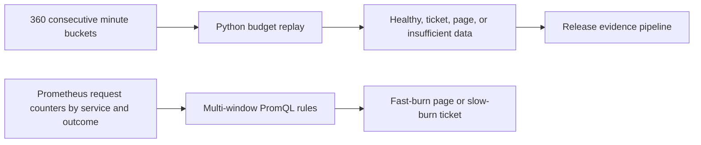

# SRE Error Budget Control Plane

Replay six hours of request counts to evaluate a 99.9% availability objective. The same fast and slow burn thresholds are available as Prometheus alert rules.

## Business problem

A short spike can page too early, while a small sustained failure rate can quietly exhaust an error budget. Responders need both short and long windows so an alert indicates a continuing problem.

## Architecture



## Design and tools

For each window, divide failed requests by total requests and normalize by the allowable error fraction. A page requires at least 14.4× burn in both the 5-minute and 60-minute windows. A ticket requires at least 6× in both 30 minutes and six hours. Replay reports both triggers and prioritizes the page. If a window has zero total requests, its burn is unknown. Missing or nonconsecutive minute buckets fail validation.

**Stack** · Python, unittest, Make, Prometheus, PromQL, promtool

## Run the demo

Use Python 3.9 or later and Make from the repository root.

```sh
make verify
python3 budget.py examples/healthy.json
python3 budget.py examples/incident.json
make verify-rules  # requires promtool
make verify-routing  # requires alertmanager
```

## Deployment

Load [the rules file](deploy/prometheus/rules.yml) through the Prometheus `rule_files` setting. The rules target a 99.9% objective and expect `http_requests_total` series with `service` and `outcome` labels. Export both success and error counters from startup. Use Alertmanager inhibition if both burn alerts fire and the page should suppress the ticket.

## Verification

Six Python tests passed. The healthy fixture returned `healthy`; the incident returned `page`. promtool parsed both rules and checked that checkout triggered both alerts while healthy catalog triggered neither. The local Alertmanager 0.35.0 drill delivered the checkout page and catalog ticket to separate webhooks and confirmed inhibition of the checkout ticket.

## Operating limits

Replay uses ordered historical snapshots and does not page responders. Zero traffic and missing scrapes need separate availability alerts in a live Prometheus installation. The Prometheus rules were evaluated with promtool fixtures.

[Architecture](docs/ARCHITECTURE.md) · [Case study](docs/CASE_STUDY.md) · [Troubleshooting](docs/TROUBLESHOOTING.md) · [Runbook](docs/RUNBOOK.md)

The [Release Evidence Pipeline](https://github.com/Klokesh493/release-evidence-pipeline) consumes this project's report in its integration demo.
