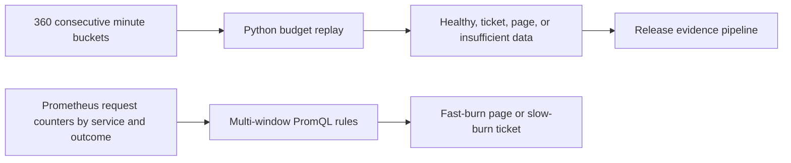

# Architecture

For each window, divide failed requests by total requests and normalize by the allowable error fraction. A page requires at least 14.4× burn in both the 5-minute and 60-minute windows. A ticket requires at least 6× in both 30 minutes and six hours. Replay reports both triggers and prioritizes the page. If a window has zero total requests, its burn is unknown. Missing or nonconsecutive minute buckets fail validation.

Load [the rules file](../deploy/prometheus/rules.yml) through the Prometheus `rule_files` setting. The rules target a 99.9% objective and expect `http_requests_total` series with `service` and `outcome` labels. Export both success and error counters from startup. Use Alertmanager inhibition if both burn alerts fire and the page should suppress the ticket.
